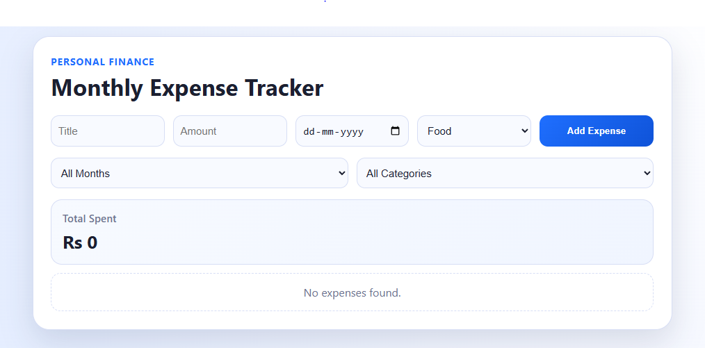
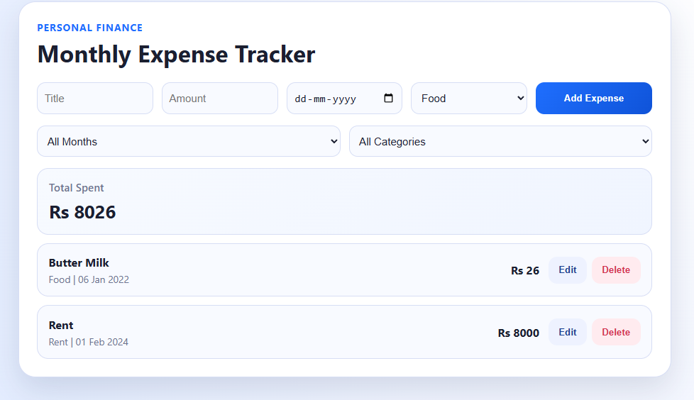
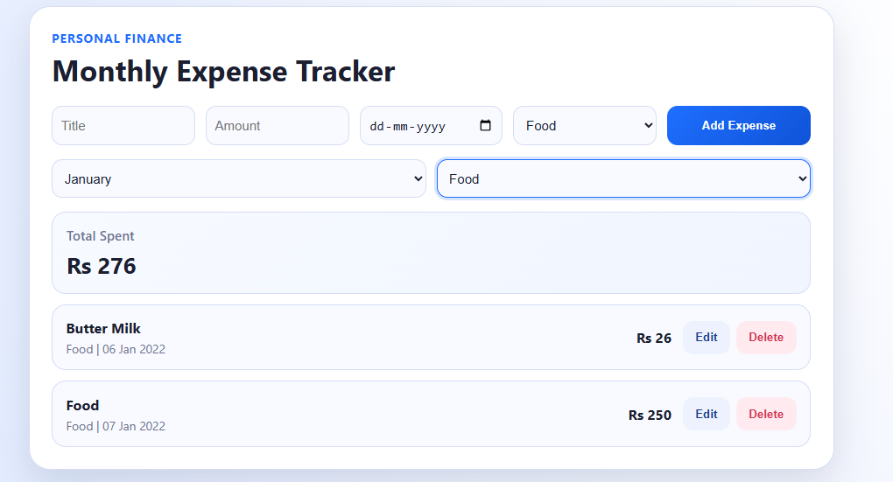
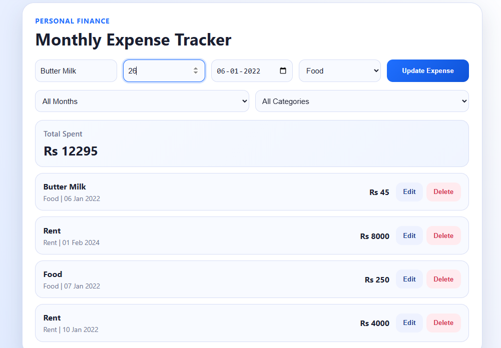

# 💰 Expense Tracker

A simple and responsive **Expense Tracker** built with **React** and **Vite** that helps users manage their daily expenses efficiently. Users can add, edit, and delete expenses while organizing them by **month** and **category**. The application provides an easy way to track spending and manage personal finances through a clean and intuitive interface.

---

## 🚀 Features

- ➕ Add new expenses with details like title, amount, category, and date.
- ✏️ Edit existing expense records.
- 🗑️ Delete expenses when they are no longer needed.
- 📅 Filter expenses by **month**.
- 🏷️ Filter expenses by **category**.
- 💰 View all expenses in an organized list.
- 📱 Responsive and user-friendly interface.

---

## 🛠️ Tech Stack

- React
- Vite
- JavaScript (ES6+)
- CSS

---

## 📂 Project Structure

```text
src/
├── assets/
├── components/
├── App.jsx
├── main.jsx
└── index.css
```

---

## 📸 Screenshots

### Home Page


### Add Expense


### Filter by Month & Category


### Edit Expense


---

## ⚙️ Installation

1. Clone the repository:

```bash
git clone https://github.com/your-username/expense-tracker.git
```

2. Navigate to the project folder:

```bash
cd expense-tracker
```

3. Install dependencies:

```bash
npm install
```

4. Start the development server:

```bash
npm run dev
```

5. Open the application in your browser using the URL displayed in the terminal (usually `http://localhost:5173`).

---

## 📖 How to Use

1. Add a new expense by entering the expense details.
2. Select a category for better organization.
3. Choose the expense date.
4. Save the expense.
5. Edit or delete any expense when needed.
6. Use the **Month** filter to display expenses from a specific month.
7. Use the **Category** filter to view expenses belonging to a selected category.

---

## 🎯 Future Improvements

- 💾 Store expenses using Local Storage or a database.
- 📊 Add charts and spending analytics.
- 🔍 Search expenses by title.
- 📈 Monthly and yearly expense reports.
- 👤 User authentication.
- 📄 Export expense reports as PDF or Excel.

---

## 🤝 Contributing

Contributions, suggestions, and improvements are welcome. Feel free to fork the repository, create a feature branch, and submit a pull request.

---

## 📄 License

This project is intended for learning and educational purposes.

---

## 👨‍💻 Author

Developed by **Nisarg Panchal**